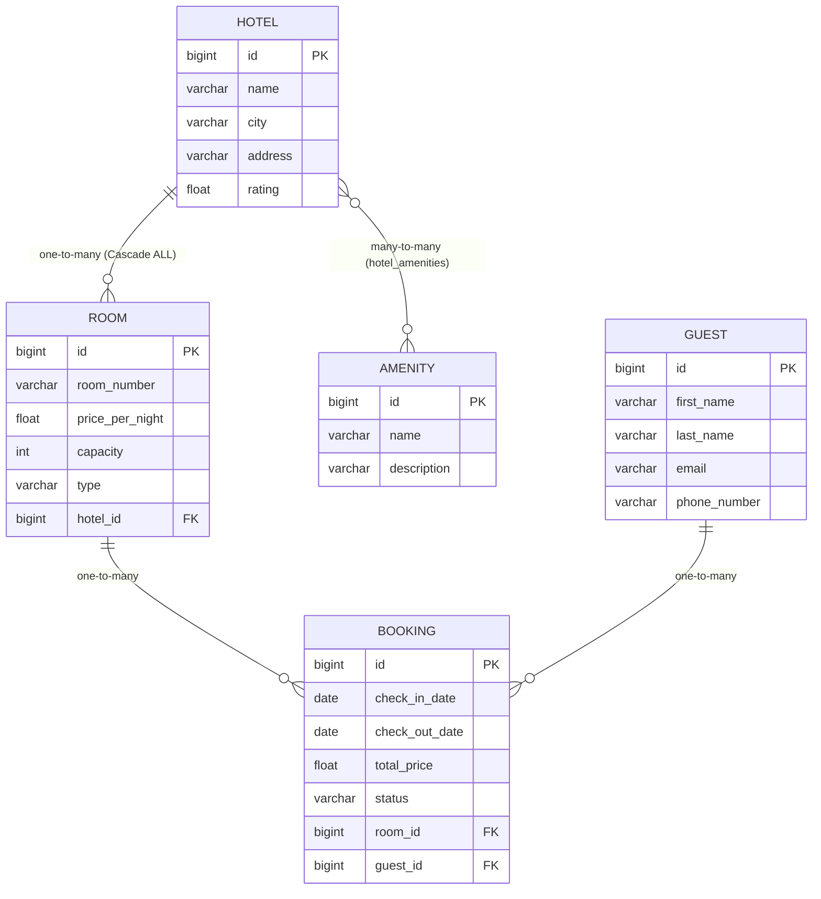

# Hotel Booking System (Система бронирования отелей)

Проект разработан для курсового проектирования и цикла лабораторных работ 1–8 по дисциплине «Программирование на платформе Java» (БГУИР, факультет КСИС).

## 🛠 Технологический стек

* **Язык разработки:** Java 21
* **Фреймворк:** Spring Boot 4 / Spring Framework
* **СУБД:** PostgreSQL 16 (с поддержкой In-Memory H2 для тестов)
* **ORM:** Spring Data JPA / Hibernate
* **Документация API:** OpenAPI 3.0 / Swagger UI (SpringDoc)
* **Логирование:** SLF4J + Logback (ротация логов по дням и размеру) + Spring AOP
* **Сборка:** Maven Wrapper
* **Контейнеризация:** Docker & Docker Compose
* **Тестирование:** JUnit 5, AssertJ, Mockito, MockMvc

---

## 🏛 ER-диаграмма предметной области (Лабораторная 2)

В модели реализовано **5 сущностей**, включая связь `@OneToMany` и `@ManyToMany`:



---

## 📋 Реализация требований по лабораторным работам

### Лабораторная 1: Basic REST service
* Реализована 3-уровневая архитектура: `Controller` $\rightarrow$ `Service` $\rightarrow$ `Repository`.
* DTO-модели для запросов (`HotelRequestDto`) и ответов (`HotelResponseDto`).
* Мапперы между Entity и DTO (`HotelMapper`).
* `@RequestParam` эндпоинт: `GET /api/v1/hotels?city=Минск&minRating=4.0`
* `@PathVariable` эндпоинт: `GET /api/v1/hotels/{id}`
* Настроен `checkstyle.xml` для проверки стиля кода.

### Лабораторная 2: JPA (Hibernate / Spring Data)
* Реляционная БД PostgreSQL подключена к проекту.
* 5 сущностей со связями `@OneToMany` (`Hotel` $\rightarrow$ `Room`), `@ManyToMany` (`Hotel` $\leftrightarrow$ `Amenity`).
* CRUD операции для всех сущностей.
* **Проблема N+1 и её решение:**
  * Эндпоинт демонстрации проблемы N+1 (множественные SELECT в логах Hibernate): `GET /api/v1/hotels/demo/n-plus-one`
  * Эндпоинт решения через `@EntityGraph` (один JOIN-запрос): `GET /api/v1/hotels/demo/n-plus-one-fixed`
* **Транзакционность:**
  * Демонстрация сохранения без `@Transactional` (частичное сохранение в БД при сбое на 3-м элементе): `POST /api/v1/rooms/bulk-demo-no-transaction`
  * Демонстрация отката с `@Transactional` (полный откат изменений): `POST /api/v1/rooms/bulk-demo-with-transaction`

### Лабораторная 3: Data Caching
* Сложный запрос с фильтрацией по вложенной сущности через JPQL:
  `GET /api/v1/hotels/search-cached?city=Минск&maxPrice=150.0&page=0&size=10`
* Аналогичный сложный запрос через Native SQL Query:
  `GET /api/v1/hotels/search-native?city=Минск&maxPrice=150.0&page=0&size=10`
* Пагинация с использованием `Pageable` и `Page<T>`.
* **In-Memory кэш на базе `ConcurrentHashMap` (`InMemoryCache<K, V>`)**:
  * Составной ключ `CacheKey` (`city`, `maxPrice`, `page`, `size`) с переопределенными `equals()` и `hashCode()`.
  * Логирование событий `CACHE HIT`, `CACHE MISS`, `CACHE PUT`.
  * Инвалидация кэша (`cache.evictAll()`) при операциях создания, обновления и удаления отелей/номеров.

### Лабораторная 4: Error Logging & Handling
* Глобальный обработчик исключений `@RestControllerAdvice` (`GlobalExceptionHandler`).
* Валидация входных данных через `@Valid` (`@NotBlank`, `@Min`, `@Max`, `@Email`, `@FutureOrPresent`).
* Единый формат ошибок `ErrorResponse` (timestamp, status, error, message, path, validationErrors).
* Логирование через **Logback** (`logback-spring.xml`):
  * Разделение уровней логирования (`INFO`, `DEBUG`, `WARN`, `ERROR`).
  * Ротация логов в архивные файлы `.log.gz` при превышении 10MB или смене суток.
* **Spring AOP:** аспект `ExecutionTimeLoggingAspect` для замера времени выполнения методов сервисного слоя.
* Подключен **Swagger UI**: доступен по адресу `http://localhost:8080/swagger-ui.html`.

### Лабораторная 5: Batch Data Processing & Testing
* Bulk-операция массового добавления номеров: `POST /api/v1/rooms/bulk`.
* Использование Java Stream API (`stream()`, `map()`, `collect()`) и `Optional`.
* Обеспечена транзакционность bulk-операции с `@Transactional`.
* Unit-тесты сервисного слоя с использованием **JUnit 5 + Mockito** (`HotelServiceTest`).
* Тестирование контроллеров через **MockMvc** (`HotelControllerTest`).

### Лабораторная 6: Concurrency
* **Асинхронная операция через `@Async` и `CompletableFuture`**:
  * Запуск задачи генерации отчета: `POST /api/v1/concurrency/async-report?city=Минск` $\rightarrow$ возвращает `taskId`.
  * Проверка статуса выполнения задачи: `GET /api/v1/concurrency/tasks/{taskId}`.
* **Демонстрация Race Condition (50+ потоков)**:
  * Запрос: `GET /api/v1/concurrency/race-condition?threads=60&increments=1000`
  * Запускает 60 потоков через `ExecutorService`, инкрементирующих обычный `unsafeCounter++` и потокобезопасный `AtomicInteger`.
  * Результат наглядно показывает потерю данных в `unsafeCounter` и точное значение в `AtomicInteger`.

### Лабораторная 8: Deploy
* `Dockerfile` с многоэтапной сборкой (multi-stage build) на базе `eclipse-temurin:21`.
* `docker-compose.yml` для одновременного развертывания PostgreSQL и Spring Boot приложения.
* Использование переменных окружения (`.env.example`).
* GitHub Actions CI workflow (`.github/workflows/ci.yml`).

---

## 🚀 Запуск и проверка проекта

### Способ 1: Локальный запуск (с Docker для PostgreSQL)
1. Запустите базу данных PostgreSQL через Docker:
   ```bash
   docker-compose up -d postgres
   ```
2. Запустите приложение через Maven Wrapper:
   ```bash
   ./mvnw spring-boot:run
   ```
3. Откройте Swagger UI в браузере:
   **[http://localhost:8080/swagger-ui.html](http://localhost:8080/swagger-ui.html)**

### Способ 2: Полный запуск в Docker Compose
```bash
docker-compose up --build -d
```

### Запуск тестов:
```bash
./mvnw test
```
